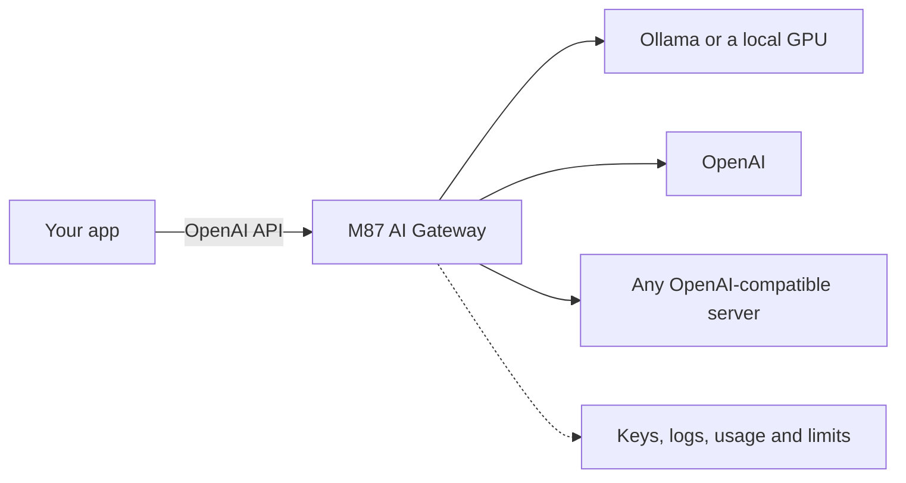

# M87 AI Gateway

A self-hosted AI gateway for developers. Put it between your app and any LLM, local
or hosted, by changing only your base URL and API key.



> Early release. It is ready to try and to run for your own projects; the API and
> configuration can still change before 1.0. See [what has been verified](docs/validation.md).

## Start it

You need Docker with Compose.

```bash
curl -fsSLO https://github.com/m87techlabs/m87-ai-gateway/releases/latest/download/docker-compose.yml
docker compose up -d
```

Get the operator key, then open **http://localhost:8087** and sign in:

```bash
docker compose exec m87-ai-gateway cat /data/gateway/admin.key
```

In the console, connect your model server in **Providers**, choose a default model, and
create an application in **Applications**. It gives you a key and copy-paste setup for your app.

| To | Run |
| --- | --- |
| Stop, keeping data | `docker compose stop` |
| Start again | `docker compose start` |
| Update | Download the Compose file again, then `docker compose pull && docker compose up -d` |
| Add Prometheus, Grafana and Loki | See [monitoring](docs/runbooks/grafana-monitoring.md) |

It restarts with Docker unless you stopped it. To build from a checkout instead, run
`docker compose up -d --build`. See [run with Docker](docs/runbooks/container-deployment.md).

## Point your app at it

Change two values. Nothing else in your code has to change.

```python
from openai import OpenAI

client = OpenAI(base_url="http://localhost:8087/v1", api_key="<application key>")
reply = client.chat.completions.create(
    model="qwen3:14b",
    messages=[{"role": "user", "content": "Hello"}],
)
```

| Your app runs | Base URL |
| --- | --- |
| On the same machine | `http://localhost:8087/v1` |
| In another Compose project on the `m87-gateway` network | `http://m87-ai-gateway:8087/v1` |

Most OpenAI SDKs also read `OPENAI_BASE_URL` and `OPENAI_API_KEY`. See
[connect your app](docs/connect-your-app.md) for model names, tools, embeddings and errors.

## What you get

| Feature | Status |
| --- | --- |
| Chat completions, streaming, tools, images and vendor options, forwarded unchanged | Implemented |
| Embeddings (`POST /v1/embeddings`) | Implemented |
| Model listing with your application's allowlist applied | Implemented |
| Ollama, OpenAI and generic OpenAI-compatible adapters | Implemented; Ollama verified live, [see validation](docs/validation.md) |
| Separate application keys, rotation and per-model allowlists | Implemented |
| Rate limits, concurrency limits, queueing, retries and response cache | Implemented, per process |
| Request logs, token usage, optional input/output capture | Implemented |
| Per-application dashboards, log filters, key use and metrics | Implemented |
| Web console with live dashboards, a Playground and on/off switches for each feature | Implemented |
| Encrypted provider keys, configuration history and rollback | Implemented |
| Prometheus metrics, Grafana dashboards, webhook and Loki export | Implemented; run them with one Compose profile |
| Fallback routes, budgets, response policies | [Planned](docs/backlog.md) |
| Anthropic, AWS Bedrock, Azure OpenAI and Vertex AI adapters | [Planned](docs/backlog.md) |
| TLS profile and a verified cloud deployment | [Planned](docs/roadmap.md) |

It runs as one instance on SQLite. Limits and cache are per process, so do not run
several replicas against one store yet.

**Before exposing it beyond your machine:** the default Compose file binds to
`127.0.0.1`. `/metrics` and the console share one port, and `/metrics` needs no key, so
put a TLS proxy with path rules in front of it. See [security](docs/security.md).

## Documentation

- [Connect your app](docs/connect-your-app.md) · [Configuration](docs/configuration.md)
- [Container deployment](docs/runbooks/container-deployment.md) · [Runbooks](docs/runbooks/README.md)
- [Security](docs/security.md) · [Observability](docs/observability.md) · [Adapters](docs/adapters.md)
- [Roadmap](docs/roadmap.md) · [Backlog](docs/backlog.md) · [What has been verified](docs/validation.md)
- [Documentation index](docs/README.md) · [Contributing](CONTRIBUTING.md) · [Changelog](CHANGELOG.md)

## License

Licensed under the [Apache License 2.0](LICENSE). Versions follow Semantic Versioning;
release criteria are in the [lifecycle](docs/lifecycle.md).
