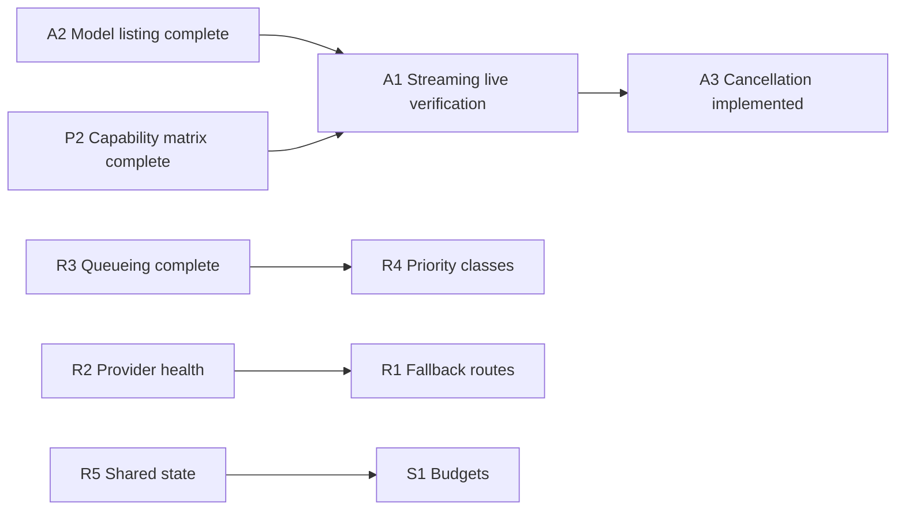

# Feature backlog

This page lists gateway capabilities that are **not implemented yet**, grouped by
area, with the scope and acceptance criteria for each. It complements the
[roadmap](roadmap.md): the roadmap sets milestones and release gates, and this page
breaks the missing work into items that can be picked up one at a time.

Status terms follow the [documentation conventions](README.md#read-implementation-status-literally).
Every item here is **planned**. When an item is implemented, remove it from this page
and record its tests and verification in the roadmap, [validation](validation.md) and the relevant runbook.

The current priorities are on the [roadmap](roadmap.md).

## Priority summary

| Priority | Item | Area | Size |
| --- | --- | --- | --- |
| P1 | [A1 Streaming live verification](#a1-streaming-live-verification) | API | L |
| P2 | [R4 Priority classes](#r4-priority-classes) | Routing | M |
| P2 | [S1 Budget enforcement](#s1-budget-enforcement) | Security | M |
| P2 | [S2 Response policies](#s2-response-policies) | Security | M–L |
| P2 | [R8 Token rate limits](#r8-token-rate-limits) | Routing | S–M |
| P2 | [R9 Per-request cache controls](#r9-per-request-cache-controls) | Routing | S |
| P2 | [S7 Personal data detection](#s7-personal-data-detection) | Security | M |
| P2 | [O6 Request tags](#o6-request-tags) | Observability | S |
| P2 | [A5 Multiple choices (`n`)](#a5-multiple-choices-n) | API | S |
| P3 | [A7/A8 Tool and image awareness](#a7-tool-calling-and-a8-multimodal-gateway-awareness) | API | M |
| P3 | [P1 Cloud and vendor adapters](#p1-cloud-and-vendor-adapters) | Providers | L each |
| P3 | [U1 Console branding](#u1-console-branding) | Console | S–M |
| P3 | Remaining items below | — | — |

Sizes are rough: S ≈ days, M ≈ one to two weeks, L ≈ several weeks.

---

## A. Inference API surface

### A1 Streaming live verification

The streaming runtime, adapter contracts and browser Stop flow are implemented;
see [streaming and cancellation](runbooks/streaming-and-cancellation.md). Remaining
work is live evidence before the original A1 acceptance gate is satisfied.

Verified against Ollama on 2026-11-03, including final usage and generation stopping on
disconnect, and through the Worker and tunnel in daily use; see [validation](validation.md).

**Scope:** repeat against OpenAI and another compatible server. Preserve unknown
counts when no provider usage arrives; do not introduce token estimates.

**Acceptance:** record provider/model versions and successful completion, token
accounting, truncation and disconnect recovery in [validation](validation.md).

### A5 Multiple choices (`n`)

**Why:** callers that want several samples for voting or ranking currently have
to send separate requests.

**Scope:** accept `n` up to a configurable maximum. Use the provider's native
support where it exists; otherwise fan out inside the gateway under the same
concurrency controls. Record one outcome event with combined usage.

**Acceptance:** usage equals the sum over all choices, limits apply, and the maximum `n` is enforced.

### A7 Tool calling and A8 multimodal: gateway awareness

Tools, images and other fields are forwarded unchanged, so they work where the model supports
them. Remaining work is making the gateway aware of them: guardrails and capture covering tool
arguments and results, image size, count and type limits, and capture of tool deltas in streams.

---

## R. Routing, reliability and traffic shaping

### R1 Fallback routes

**Status:** implemented on 2026-11-05. See the [runbook](runbooks/fallback-routes.md) and [validation](validation.md).
Remaining: skipping a known-dead provider, which is [R2](#r2-provider-health-and-circuit-breaking).

**Why:** when the primary provider is unreachable (for example, a home GPU
is switched off), requests fail even when another authorized provider exists.

**Scope:** ordered fallback targets per route, triggered only on retryable failure
classes (connection refused, timeout, 5xx, provider 429) and never on client
errors. Each fallback target must be authorized for the application. The outcome
event records which target served the request.

**Acceptance:** tests cover each trigger class, rejection of an unauthorized
fallback target, attribution in logs and usage, and recovery once the primary returns.

### R2 Provider health and circuit breaking

**Why:** `/ready` checks configuration and storage, not whether providers can be
reached. Repeated calls to a dead provider waste time before each failure.

**Scope:** optional background health probes, provider status in the console, and
a circuit breaker that opens after repeated failures and probes again half-open.
Keep `/ready` semantics unchanged, or add a separate endpoint for provider health.

**Acceptance:** the breaker opens, half-opens and closes under test, the console
shows status, and probes never send captured content or completions.

### R4 Priority classes

**Why:** interactive and batch traffic share the same capacity, and batch jobs
can starve interactive users.

**Scope:** a priority class on each application (for example, interactive/batch),
scheduled in priority order from the queue, with starvation protection for lower classes.

**Acceptance:** under saturation, interactive requests get ahead of batch requests,
and batch requests still progress within a documented bound.

### R5 Shared state for multiple processes

**Why:** rate limits, concurrency, cache and (later) budgets are kept per process,
so running several gateway processes multiplies every limit.

**Scope:** a shared-state backend interface for counters, semaphores and cache,
with an in-process default and one external implementation (for example, Redis or PostgreSQL).

**Acceptance:** with two processes behind one load balancer, the combined limits
match the configuration in both functional and load tests.

### R6 Load balancing and weighted routing

**Scope:** several targets per route, using weighted round-robin or least-busy
selection, with health awareness (needs [R2](#r2-provider-health-and-circuit-breaking)).

**Acceptance:** traffic is distributed within tolerance and unhealthy targets are removed.

### R7 Semantic cache

**Scope:** an optional cache keyed by embedding similarity, scoped per application
and model, with a similarity threshold, TTL and exclusions.

**Acceptance:** cache hits never cross applications and are labelled as cache hits
in usage. An opt-out works for each request.

---

### R8 Token rate limits

**Why:** requests per minute treats a short question and a huge prompt the same. Providers and other gateways limit
tokens too.

**Scope:** tokens per minute per application, using provider-reported usage, with a clear 429 like the existing limit.

**Acceptance:** an app over its token limit is refused without affecting others. Requests with unknown usage are
handled by a documented rule, and streaming usage is counted.

### R9 Per-request cache controls

**Why:** one app setting cannot suit every request. Some must never be cached.

**Scope:** request headers to skip the cache and to set a shorter lifetime, and a response header reporting hit or miss.

**Acceptance:** a skipped request neither reads nor writes the cache, a caller cannot extend a lifetime beyond the
gateway's setting, and hits stay per application.

---

## S. Security and governance

### S1 Budget enforcement

**Why:** `monthly_budget_usd` is validated but not enforced.

**Scope:** budgets per application and per project in tokens, in estimated cost,
or both, over daily or monthly windows. Choose soft (warn) or hard (reject)
behaviour. Show remaining budget in the console.

**Acceptance:** a hard budget fails closed at the limit, a soft budget emits events,
and windows reset correctly. Cache hits do not consume budget.

### S2 Response policies

**Why:** guardrails check requests only. Outputs are not checked for secrets,
personal data or blocked content.

**Scope:** a pluggable output policy chain (redact, block or flag), with built-in
secret and PII pattern detectors. Policy outcomes appear in events and metrics.
Define how this works with streaming, for example chunk buffering or
check-on-completion.

**Acceptance:** each action is tested for non-streaming and streaming responses.
Policies never write the matched sensitive content to logs.

### S3 Prompt-injection detection

**Scope:** an optional request detector (heuristic or model-based) that can flag
or block, plus a documented test corpus.

**Acceptance:** precision and recall on the corpus are recorded, and flag-only mode
never blocks traffic.

### S4 Key versions and remaining management audit

**Why:** application-key lifecycle, configuration/provider-key audit, encrypted
settings history, atomic activation and rollback are implemented. Crypto key versions
still need coverage. Explicit content/log deletion is now audited.

**Scope:** versioned master/digest keys with re-encryption, remaining management
actions and stable connection identities for multiple connections of one adapter.

**Acceptance:** a master key can be rotated without losing application-key validity
or provider secrets, remaining management changes appear in audit, and migration/
backup/recovery pass shared contracts. Current settings rollback never restores old secrets.

### S5 Operator roles

**Status:** implemented with [single sign-on](runbooks/single-sign-on.md), with admin and read-only
roles. Negative tests cover every admin route. Verified against Keycloak 26; see
[validation](validation.md).

**Remaining:** back-channel logout, and throttling admin key attempts, which is on the
[roadmap](roadmap.md).

### S6 Project policy and tenant boundaries

**Scope:** per-project model allowlists, limits, budgets, retention and capture
policy, with tested isolation between projects.

**Acceptance:** cross-project access tests fail closed before any tenant-isolation
claim is made.

---

### S7 Personal data detection

**Why:** prompts leave for third-party providers, and teams want to know or stop that when they hold personal data.

**Scope:** detect common patterns such as email addresses, phone numbers and card numbers in requests, and flag, redact or
block by application. Local patterns first, with no external service.

**Acceptance:** each action is covered by tests, detection is labelled best effort, and matched values never appear in
logs, metrics or exports.

---

## O. Observability

### O2 Remote log exporters

Webhook and Loki delivery are implemented, with a bounded queue that survives restarts.

**Scope:** OTLP logs, direct Loki Basic and tenant headers, and an explicit policy for exporting content.

**Acceptance:** delivery survives outages and restarts, and no captured content leaves unless enabled.

### O3 Distributed tracing

**Scope:** OpenTelemetry spans for authentication, policy, routing, each provider
attempt, retries and cache. Propagate `traceparent` from callers.

**Acceptance:** one trace shows every attempt of a request that was retried or fell back.

### O4 Latency and throughput metrics

**Scope:** time to first token, tokens per second and queue wait, broken down by
provider, model and application. Needs [implemented queueing](runbooks/inference-api-and-queueing.md).

### O5 Cost and resource estimates

**Scope:** cost estimates per model from a maintained, labelled price table,
and GPU-seconds or token throughput for self-hosted providers.

**Acceptance:** estimates are clearly marked as estimates, and maintaining the price table is documented.

---

### O6 Request tags

**Why:** apps often need usage split by something the gateway cannot see, such as a customer or feature.

**Scope:** a bounded metadata header, stored with the request, filterable in Logs and exported to Loki. Not a metric label,
so it cannot grow without limit.

**Acceptance:** size and count limits are enforced, tags filter in Logs and Loki, and they reach neither metric labels nor
providers.

---

## C. Connectors

### C1 Connectors (parked)

**Status:** parked on 2026-11-05. Designed, not started.

**Why:** today a user connects Grafana by editing their own Prometheus and copying files. Someone with managed Grafana
cannot do it from the console, and Prometheus cannot pull from a gateway it cannot reach.

**Scope:** a **Connectors** page with one card per service, each with an on/off switch, settings, a connection test and last
status, reusing log export's encrypted secrets, history and audit. Grafana installs dashboards through its API. Metrics push
through OTLP, or offer an authenticated scrape address. Logs add Basic authentication and tenant support, and the Log export
page moves here. Alerts add an Alertmanager address and a test alert. Single sign-on moves to the console last, because a bad
setting could lock people out: it must pass a test before saving, and the admin key remains the way back.

A connector links to a service that is already running. The console does not start containers.

**Acceptance:** a Grafana Cloud user gets dashboards and data from the console alone, verified against a real account.

---

## U. Console

### U1 Console branding

**Why:** the console currently uses a plain text "M87" placeholder and a neutral palette. It
should look like an M87 product, with an identity of its own.

**Scope:** replace the placeholder with the official M87 mark, and create a gateway identity that
matches the M87 theme: a lockup or product mark, a favicon, a palette and a sign-in screen. The
official artwork and palette (amber, gold, jet blue, space navy) are in the M87 brand folder; Horizon
and Sentinel are existing examples. Apply it through the console's CSS tokens, in both themes.

Decide first how logo files may be used in this public, Apache-2.0 repository, and keep them in one
replaceable place, because the product name may still change.

**Acceptance:** the mark and favicon appear on sign-in and in the sidebar in both themes, text and
controls keep readable contrast, and chart and status colours stay distinct from brand accents.

---

## P. Providers

### P1 Cloud and vendor adapters

Anthropic, AWS Bedrock, Azure OpenAI and Google Cloud Vertex AI. Each needs
credential configuration (workload identity where supported), model mapping, error
normalization, a declared capability set, the shared contract suite and an
opt-in live smoke check.

### P3 Live verification of existing adapters

OpenAI and generic OpenAI-compatible servers (vLLM) still need recorded live evidence in [validation](validation.md).

---

## D. Platform, storage and distribution

| Item | Scope |
| --- | --- |
| D1 Backend storage | Content encryption and access roles; PostgreSQL and Vault adapters behind the existing contracts |
| D4 Cloud deployment | TLS Compose profile, authenticated metrics, admin throttling, and a runbook verified on a real cloud host |
| D5 Developer experience | JavaScript and Python client examples, a stable published adapter interface with a minimal example adapter |
| D6 Compose profiles | An Ollama profile, so a model server can start with the gateway |
