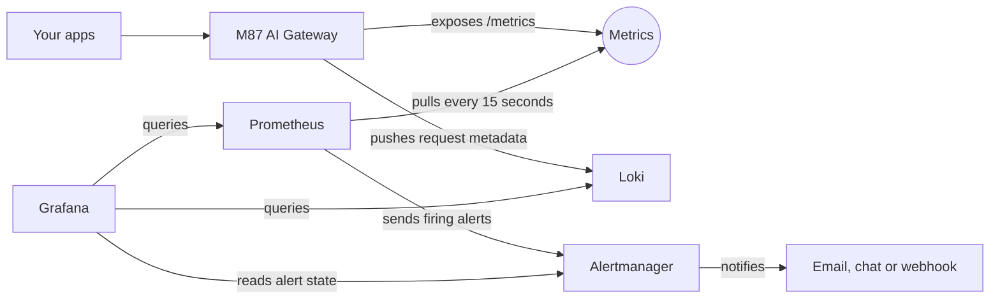

# How data reaches Grafana

The gateway can feed Grafana with three kinds of data: metrics, logs and alerts. Grafana stores none of it. It
reads from Prometheus, Loki and Alertmanager, and each of those gets its data a different way.



| | Metrics | Logs | Alerts |
| --- | --- | --- | --- |
| **Direction** | Prometheus pulls from the gateway | The gateway pushes to Loki | Prometheus sends to Alertmanager |
| **Holds** | Counts and timings | One record per request | Firing and resolved alerts |
| **Set up in** | Your Prometheus configuration | The console's **Log export** page | Your Prometheus and Alertmanager configuration |
| **If the receiver is down** | A gap in the graphs | Records wait in a queue and arrive later | Nobody is notified |

## Metrics

The gateway keeps running counts and publishes them at `/metrics`. It does not know Prometheus exists. Prometheus
fetches the page on a schedule and keeps the history, so the numbers in Grafana are always Prometheus's copy:

```text
m87_gateway_requests_total{app_id="my-app",provider="ollama",status_code="200"} 327
```

Because the application key identifies the caller, every app gets its own series. That is what lets a dashboard
split traffic, tokens and latency by application.

Counts are held in memory and reset when the gateway restarts. Prometheus handles that reset correctly when it
calculates rates. See the [full list of metrics](observability.md#metrics).

## Logs

Each request creates a metadata record, such as application, project, model, status, tokens, latency, cache status
and retries. The gateway queues it and pushes it to Loki, retrying if Loki is away. By default the queue holds
5,000 records for 7 days. Turn it on under **Log export** in the console.

```logql
{service_name="m87-ai-gateway", log_kind="llm_exchange"} | json | app_id="my-app"
```

Only metadata leaves the gateway. Prompts and responses are not exported, even with
[capture](features.md#logging) on. They stay in the console's Logs page.

## Alerts

Prometheus checks the included [alert rules](runbooks/grafana-monitoring.md#3-review-alert-thresholds-and-routing) against the
metrics, for example whether the gateway has stopped answering scrapes or more than 5% of requests are failing.
Firing alerts go to Alertmanager, which groups them and sends notifications. A firing rule alone tells nobody, so
[prove delivery](runbooks/grafana-monitoring.md#send-alert-notifications) once it is set up.

## What you can see

| Question | Where |
| --- | --- |
| How much traffic is each app sending? | **M87 Gateway Overview**: Requests by application |
| Which app uses the most tokens? | Overview: Provider tokens per second by application |
| Is it getting slower, and for whom? | Overview: Request p95 duration, overall and by application |
| Are requests failing? | Overview: Requests by status, HTTP 5xx fraction, Provider failures |
| Is the cache helping? | Overview: Cache lookups per second |
| Are apps hitting their limits? | Overview: Rate-limit rejections, Concurrency queue depth |
| What happened to this request? | **M87 Gateway LLM Metadata**: filter by project, application or request ID |
| Is the monitoring itself healthy? | Overview: Scrape availability, Export pending records, Export drops |

## Choose how to run it

| You have | Do this | You get |
| --- | --- | --- |
| No monitoring yet | `docker compose --profile monitoring up -d` | Prometheus, Loki, Alertmanager and Grafana, already connected |
| Your own Prometheus and Grafana | [Copy the scrape job, rules and dashboards](runbooks/grafana-monitoring.md#use-your-own-services) | The same dashboards in your existing Grafana |
| Your own Loki | Set its address under **Log export** | Request metadata in your Loki |

For a managed service such as Grafana Cloud, Prometheus still has to be able to reach `/metrics`, and direct Grafana
Cloud log authentication is [not supported yet](runbooks/loki-export.md). A
[connector](backlog.md#c1-connectors-parked) that sets this up from the console is parked in the backlog.

## Limits

- `/metrics` needs no key. It holds application names and counts, so keep it on a private network and out of any public
  route.
- Loki has no authentication in the included setup. Keep it on a private network or on loopback.
- A gateway that is down publishes nothing. `M87GatewayDown` covers that, and the graphs show a gap.

See [what has been verified](validation.md).
