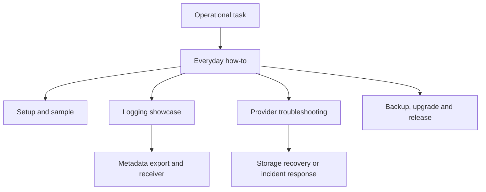

# Runbooks

These procedures describe the current gateway unless a step is explicitly marked
as a release requirement. Run commands from the repository root. Use synthetic
prompts and private credentials; redact logs before attaching them to issues.

| Runbook | Use when |
| --- | --- |
| [Local development](local-development.md) | Installing, testing, or starting a development instance |
| [Portable workstation preview](workstation-distribution.md) | Native artifacts, lifecycle, encrypted backup/restore and upgrade checks |
| [Guided setup](guided-setup.md) | Start the included console, configure inference, or use the source/native preview |
| [Gateway controls acceptance](gateway-controls-testing.md) | Configure controls and run isolated sample failure/recovery scenarios |
| [Projects and usage](projects-and-usage.md) | Create projects, inspect usage, move applications, and use the API tester |
| [Windows/WSL flow lab](windows-wsl-flow-lab.md) | Exercise browser, relay, gateway, and Windows Ollama without Docker |
| [Container deployment](container-deployment.md) | Starting a single gateway container and checking provider connectivity |
| [Configuration changes](configuration-changes.md) | Changing routes or rotating an app key |
| [Provider troubleshooting](provider-troubleshooting.md) | A chat request fails or returns unexpected behavior |
| [Traffic controls](traffic-controls.md) | Configure and verify per-app limits, cache, and retries |
| [Traffic logging](traffic-logging.md) | Enable and inspect bounded private LLM request/response records |
| [Local control plane](control-plane.md) | Inspect usage and exchanges; manage local application/provider keys |
| [End-to-end flow testing](end-to-end-flow-testing.md) | Verify Worker, Access, Tunnel, gateway, Ollama, logs, and metrics |
| [Incident response](incident-response.md) | Requests fail broadly or credentials may be exposed |
| [Release](release.md) | Preparing, publishing, or rolling back a version |

## Additional operational procedures

| Runbook | Use when |
| --- | --- |
| [Everyday gateway and sample how-to](daily-operations.md) | Start/stop/status, configure a sample, showcase logs and resolve common errors |
| [Backend storage acceptance](backend-storage-testing.md) | Verify repository contracts, migrations and independent retention |
| [Application-key rotation](application-key-rotation.md) | Replace keys with overlap/expiry, revoke credentials and inspect audit |
| [Inference API and queueing](inference-api-and-queueing.md) | Test model catalog, generation options and bounded admission |
| [Streaming and cancellation](streaming-and-cancellation.md) | Test streaming, Stop, partial capture and cancellation |
| [Configuration recovery and storage health](configuration-recovery.md) | Review/restore settings and investigate private-store failures |
| [Logging showcase](logging-showcase.md) | Inspect input/output, tokens, capture states, search, exports and deletion |
| [Grafana dashboards and alerts](grafana-monitoring.md) | Set up optional metrics/log dashboards, validate rules and troubleshoot alerts |
| [Loki metadata export](loki-export.md) | Configure an existing Loki endpoint, query request metadata and recover delivery |
| [Configure log export](configure-log-export.md) | Set destinations and encrypted credentials, test drafts and enable delivery |
| [Metadata webhook export](log-export.md) | Configure the receiver, test outages/restarts and recover pending delivery |

## Runbook standard

Every implemented operator workflow needs a runbook or how-to in this directory,
linked here and from the related feature documentation. Keep setup, commands,
prerequisites, success checks, troubleshooting, recovery and stop instructions in
these pages; chat updates are summaries. Update the procedure with its implementation.
Preserve existing pages and link to shared procedures instead of duplicating them.
Distinguish source, native and Docker commands, data directories and verification.
Document unimplemented integrations as planned and deferred tests in
[validation](../validation.md). Never include actual keys or personal workstation details.

