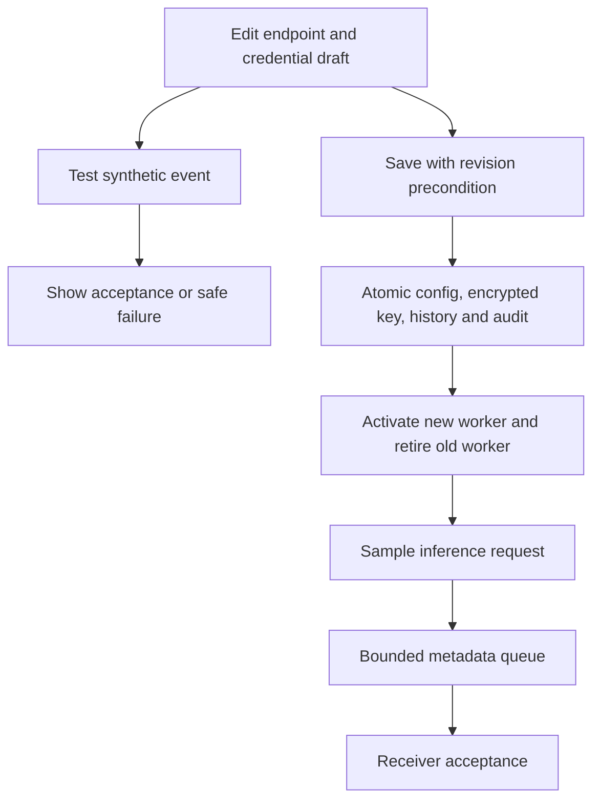

# Configure log export in the console

## Use this when

Use **Log export** to configure an existing webhook receiver, store its bearer token
in the gateway, test a draft, and enable/disable delivery without restarting. This
is gateway-wide metadata export. Input/output remains in local **Logs**; Loki/OTLP
and remote content export are planned.

Prerequisites: the gateway is running, you have its operator key, and a webhook
receiver is reachable. The bundled SQLite backend supports this workflow. External
backends need both the outbox and transactional export-credential management contracts.
Back up before upgrading: schema 9 preserves existing data and adds encrypted export
credential storage. See [portable backup/restore](workstation-distribution.md#backup-and-restore).

## Start a demonstration receiver

From the source checkout root, in a separate terminal:

```bash
read -rs -p 'Demo receiver bearer token: ' M87_LOG_RECEIVER_TOKEN; echo
export M87_LOG_RECEIVER_TOKEN
.venv/bin/python -m examples.log_receiver.start
```

Choose a long private test token without whitespace; use the same value in the gateway's
password field. Do not place it in a command argument or commit it. The example
listens on `http://127.0.0.1:9087/events` and stores private deduplicated metadata in
`var/lib/log-receiver/deliveries.db`. The receiver runs separately from the gateway
and is a source-only demonstration. Stop it with Ctrl+C.

Use [metadata webhook operations](log-export.md) for the receiver's storage,
inspection commands, outage exercises and optional startup environment settings.

## Configure, test and save

1. Open the gateway console, authenticate as operator, and select **Log export**.
2. Choose **webhook** and enter the exact receiver endpoint. For the local example,
   use `http://127.0.0.1:9087/events`. Use HTTPS for remote authenticated receivers.
3. Choose authentication:

   | Choice | What to provide |
   | --- | --- |
   | No authentication | A receiver that accepts metadata without a bearer token |
   | Credential stored in gateway | Paste a new token into the password field. Leave it empty on later saves to retain a matching saved token. |
   | Environment variable | Name a token variable already supplied to the gateway process. This option does not set the variable. |

4. Review pending-record capacity, queue retention, HTTP timeout, polling and retry
   bounds. Defaults are 5,000 pending records, 168 hours, 5-second timeout, 1-second
   polling and 2-second exponential retries capped at 300 seconds.
5. Choose **Test connection**. The gateway sends one marked synthetic event using
   the draft endpoint and selected credential. The test does not save config/token,
   enqueue a delivery, change the worker, or increment persistent delivery counters.
   The receiver may store that test event. A successful test proves acceptance of
   that event; it does not establish receiver retention, dashboards or availability.
6. Select **Enable metadata export** and choose **Save export settings**. Settings,
   encrypted token, history revision and audit commit together. The worker changes
   immediately after a successful commit; the form clears the token field.
7. Send a synthetic request from the sample app or API tester. In **Logs**, match its
   request ID and inspect export pending/delivered/failure/drop/expiry counts. Check
   the same request ID and tokens in the receiver using its inspection procedure.

Settings persist across restart and take precedence over export bootstrap values.
The secret is encrypted with the gateway's local master key, bound to adapter and
endpoint, and excluded from config responses, history snapshots and audit records.
The saved token is never shown again. Console drafts remain in page memory until
save/lock; they are not written to browser storage. Lock clears credential fields
and aborts a pending probe. Already accepted remote events cannot be recalled.



## Change destination, token or enabled state

- Replace the token by choosing stored credentials and entering a fresh value.
  A replacement for the same destination applies to pending retries too.
- When the adapter, endpoint or credential source changes while a credential exists,
  provide a new token or select **Confirm removal of the previous saved credential**.
  The same protection applies to draft tests: a saved token is never automatically
  forwarded to a changed receiver.
- To remove a stored token and use no authentication, choose **No authentication**,
  select the removal confirmation, and save. To use another environment binding,
  select it explicitly and confirm removal of the previous credential.
- Uncheck **Enable metadata export** and save to stop the worker. Existing pending
  metadata remains in the queue until expiry/activity. New requests still get local
  logs/usage but do not enqueue exports while disabled. Re-enable and save to resume
  matching pending deliveries.
- Pending records stay bound to their original adapter/endpoint; they are held after
  a destination change and never forwarded to the new receiver. Restoring that
  destination resumes them until expiry. Held records consume queue capacity.
- A request already sent before a change may still be accepted. Interrupted claims
  can wait for their timeout-plus-30-second lease to expire before retrying. Receivers
  deduplicate stable delivery IDs.

## Troubleshooting and recovery

| Symptom | Recovery |
| --- | --- |
| Test rejected | Check endpoint and bearer token. Remote error bodies/credentials are excluded from the result. |
| Test cannot connect | Check receiver startup, hostname/network path, TLS and configured timeout. Redirects are rejected and proxy environment variables are ignored. |
| Credential confirmation required | Supply a fresh stored token or explicitly confirm removal when changing destination/source. |
| Missing stored/environment token | Enter a new stored token or supply the named variable to the process. Saving an enabled connection requires its credential to be available. |
| Configuration changed | Refresh the page before retrying. The console sends an ETag precondition; stale saves cannot activate. Re-enter a fresh token after a failed save. |
| Storage unavailable | Inspect Storage health, permissions, free space and competing writers. Failed transactions keep the previous settings, token and worker. |
| Pending or held grows | Restore the receiver or original destination before expiry; inspect capacity/drop counters. See [delivery boundaries](log-export.md#delivery-and-storage-boundaries). |

**Configuration history** includes export settings, excluding credential values.
Restoring unchanged bindings retains current credentials. Restoring a changed export
binding requires removal confirmation, clears its saved/environment credential
binding and disables export; reconfigure in Log export before enabling. It never
revives a historical token. Older revisions without export fields preserve the
current export settings. Explicit credential changes are audited locally under the
shared operator role; this audit is not tamper-proof.

Encrypted backups include the saved export token and pending queue. Restore only
with the matching database/key pair into a fresh destination. Restored pending
records may replay to the matching endpoint, so preserve receiver deduplication.
Storage health checks export credential decryption. Backup validation also verifies
that an enabled stored credential matches its configured destination. Local deletion does not erase queued metadata or recall receiver records.

## Automated verification and shutdown

```bash
.venv/bin/python -m pytest -q tests/test_export_configuration.py tests/test_log_export.py
.venv/bin/python -m examples.chat_app.scenarios
npm test --prefix tests/console
```

These checks use temporary stores and synthetic endpoints. The sample suite has
17 scenarios, including console export testing and metadata delivery. Native smoke
also tests saved tokens and encrypted recovery without relying on startup token
variables. See [validation](../validation.md) for live/manual and packaging limits.

To finish the demonstration, disable export and save, stop the sample with
`./examples/chat_app/stop.sh`, then stop the gateway with `./stop.sh`. Stop the
foreground receiver with Ctrl+C. Private databases remain available for next time.
