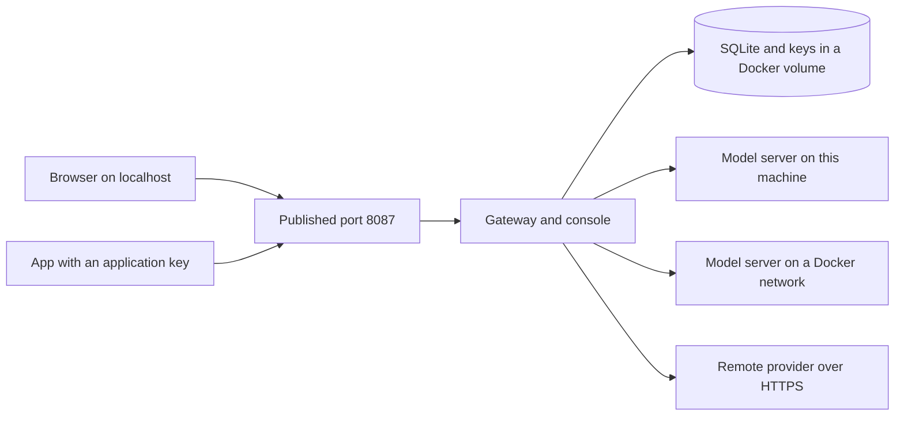

# Run with Docker

Docker Compose is how the gateway is packaged and run, on a laptop or a server. You need Docker
Engine or Docker Desktop with Compose v2. Images are built for Linux amd64 and arm64.

The image holds the gateway, its console and SQLite, and runs as a non-root user on a read-only
filesystem. It does not include models. Bring your own model server or provider account.

## Start

To run a release, download its Compose file. It is pinned to that release's image:

```bash
curl -fsSLO https://github.com/m87techlabs/m87-ai-gateway/releases/latest/download/docker-compose.yml
docker compose up -d
```

To build from a checkout, for example to change the code:

```bash
git clone https://github.com/m87techlabs/m87-ai-gateway.git
cd m87-ai-gateway
docker compose up -d --build
```

Get the operator key, then open **http://localhost:8087** and sign in:

```bash
docker compose exec m87-ai-gateway cat /data/gateway/admin.key
```

The key never appears in container logs. See [guided setup](guided-setup.md) for what to do next.

## Everyday commands

Run these from the folder holding `docker-compose.yml`.

| To | Run |
| --- | --- |
| Check status | `docker compose ps` |
| Stop, keeping data | `docker compose stop` |
| Start again | `docker compose start` |
| Follow logs | `docker compose logs -f` |
| Remove the container, keeping data | `docker compose down` |
| Delete everything, including keys and logs | `docker compose down --volumes` |

The gateway restarts with Docker unless you stopped it. `/health` returns 200 once it is running.
`/ready` returns 503 until a provider is set up, and it checks configuration and storage rather than
whether the provider is reachable.

## Settings

Put these in a `.env` file beside `docker-compose.yml`. All are optional.

| Variable | Default | Purpose |
| --- | --- | --- |
| `GATEWAY_PORT` | `8087` | Host port |
| `GATEWAY_BIND` | `127.0.0.1` | Host address. Read [security](../security.md) before changing it |
| `GATEWAY_ADMIN_API_KEY` | generated | Operator key, at least 24 characters |
| `OLLAMA_BASE_URL` | `http://host.docker.internal:11434` | Suggested endpoint for a model server on this host |
| `GATEWAY_IMAGE` | the release's image | Image to run, such as a specific version |

Everything else is set in the console, not in files.

## Connect your apps

Apps on the same machine use `http://localhost:8087/v1`. Apps in another Compose project can join
the `m87-gateway` network and use `http://m87-ai-gateway:8087/v1`. See
[connect your app](../connect-your-app.md).

## Reach your model server

`localhost` inside the container means the container, not your machine.

| Model server | Endpoint in the console | Notes |
| --- | --- | --- |
| On this machine, with Docker Desktop | `http://host.docker.internal:11434` | Works with Ollama's default settings |
| On this machine, on Linux | `http://host.docker.internal:11434` | Ollama listens on `127.0.0.1` by default, so set `OLLAMA_HOST=0.0.0.0:11434` and restrict that port with a firewall |
| In another container | `http://ollama:11434` | On a shared Docker network |
| Remote, OpenAI-compatible | `https://inference.example.invalid/v1` | Needs DNS, outbound access and any credentials |
| OpenAI | `https://api.openai.com/v1` | Save the key in **Providers** |



Use **Test connection** in **Providers** to check the path from inside the container.

## Your data

Everything lives in the `gateway-data` volume: the database, master key and operator key. Keep them
together. Run one gateway per volume, because SQLite, limits and the cache support a single instance.
Anyone who administers Docker on the host can read volumes.

## Backup and restore

Stop the gateway, then create an encrypted archive and copy it out of the volume. You are asked for
a password of at least 12 characters. Keep it separately: a lost password cannot be recovered.

```bash
docker compose stop
docker compose run --rm m87-ai-gateway --data-dir /data/gateway --backup /data/my-backup.m87backup
docker compose run --rm -T --entrypoint cat m87-ai-gateway /data/my-backup.m87backup > my-backup.m87backup
docker compose start
```

To restore, use a separate Compose project so the original stays untouched until you have checked
the result. Restoring only works into an empty directory. For automation, you can pass the password
privately through `GATEWAY_BACKUP_PASSWORD`, which the command below requires:

```bash
docker compose stop
read -r -s GATEWAY_BACKUP_PASSWORD; export GATEWAY_BACKUP_PASSWORD
docker compose -p m87-restored run --rm -e GATEWAY_BACKUP_PASSWORD -T --entrypoint sh m87-ai-gateway \
  -c 'cat > /tmp/in && m87-gateway --data-dir /data/gateway --restore /tmp/in' < my-backup.m87backup
unset GATEWAY_BACKUP_PASSWORD
docker compose -p m87-restored up -d
```

Check sign-in, applications, logs and a test request. Keep using `-p m87-restored` from then on, and
delete the old project's volume only once you are satisfied.

An archive contains the database, master key and stored operator key, including captured content
and encrypted credentials. It excludes environment variables and models. Treat it as sensitive even
though it is encrypted. Restoring can replay pending log exports, so receivers should deduplicate.
Archives are limited to 256 MiB, which you can reach with heavy content capture.

## Upgrade and roll back

1. Create a backup. Upgrades can migrate the database, and an older image refuses a newer database.
2. Get the new release:

   ```bash
   curl -fsSLO https://github.com/m87techlabs/m87-ai-gateway/releases/latest/download/docker-compose.yml
   docker compose pull
   docker compose up -d
   ```

   From a checkout, run `git pull` and `docker compose up -d --build`.
3. Check sign-in, applications, logs and a test request.

To roll back, restore your backup into a new project with the previous version's image, set through
`GATEWAY_IMAGE`. Rollback between released versions has not been tested yet, because this is the
first release.

## Automated checks

CI runs `scripts/smoke_container.py` on each push, against a synthetic model server with isolated
volumes and ports. It covers Docker and Compose startup, permissions, setup, authentication, a
completion, captured content, persistence and shutdown. It never calls a paid API.
See [validation](../validation.md) for what has been checked by hand.
