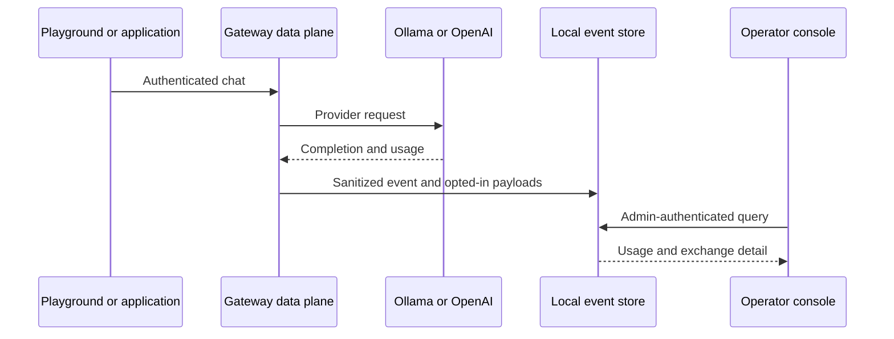

# Control-plane runbook

Use this runbook to operate the console on one gateway instance. Start the gateway with
[Docker](container-deployment.md), open `/admin` and sign in with the operator key. Then confirm, after
sending a synthetic request from the **Playground**:

- **Overview** token totals increased by the provider-reported usage.
- **Logs** contains the same `X-Request-ID` shown in the Playground.
- Request details show the selected route, status and latency.
- **Log export** lists where data goes.

## Create an application key

Open **Applications**, enter a generic app ID and explicit model allowlist, and
choose request limits as needed. Enable gateway-wide payload capture in **Features**. Copy the generated key immediately;
the console cannot show it again. Place it only in the application's server-side
secret storage. Revoke the row to invalidate it.

## Store or rotate an OpenAI key

Open **Providers**, select OpenAI, retain the `default` alias, and enter the
new key. Saving the same provider and alias atomically replaces the encrypted
value. Run a synthetic OpenAI request before retiring the old credential at the
provider. The UI and list API never return the secret.

## Export and retention

Use **Logs → Export JSON** for a bounded operator export. Exports can contain
captured prompts and completions. Store them as sensitive data and delete them
under the same retention policy as the source events.

The gateway prunes expired SQLite events at startup, on settings saves, and on event
writes. Change retention in **Features**; its saved value overrides the startup
`GATEWAY_CONTROL_PLANE_RETENTION_DAYS` value. Back up `control.db` and
`master.key` together while access is restricted. Keep the master key separate
from ordinary database-only backups when possible.

## Recovery

- Lost admin key: set a new `GATEWAY_ADMIN_API_KEY` and restart. Stored data and
  application/provider keys remain valid.
- Lost master key: application digests and provider ciphertext cannot be used;
  restore the matching key or recreate runtime keys and provider credentials.
- Corrupt database: stop the gateway, preserve the files for investigation,
  restore the matching database/key backup, and run health plus synthetic chat.
- Suspected disclosure: rotate the admin key, affected app keys, and provider
  credentials; export relevant metadata; then follow incident response.

Never publish the database, master key, exports, prompts, completions, or live
credentials in issues, commits, logs, or test evidence.
