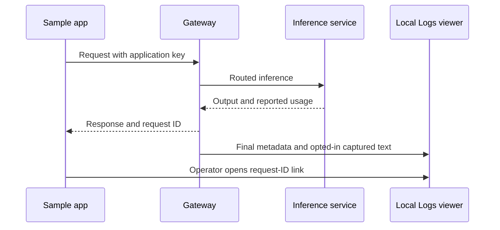

# Everyday gateway and sample-app how-to

## Use this when

Use this page to start or stop the gateway, run the sample app and read LLM logs. Commands run from the
folder holding `docker-compose.yml`.

## Prerequisites

- A running gateway; see [run with Docker](container-deployment.md).
- A model server or provider, with a model available.
- Back up existing data before upgrading; see [backup and restore](container-deployment.md#backup-and-restore).
- Keep the operator key and application keys private. They serve different roles.

## Start, status and stop

```bash
docker compose up -d
docker compose ps
docker compose stop
```

Stopping keeps data. The gateway publishes port 8087; set `GATEWAY_PORT` in `.env` to change it.

To try the sample app from a checkout, see [its instructions](../../examples/chat_app/README.md).

## Configure and demonstrate logs

1. Open the gateway console URL and authenticate with its operator key.
2. In **Providers**, configure inference, use **Test connection**, save the connection,
   and select an installed model as the default. Discovery tests reachability;
   a completion establishes that inference works.
3. Enable **Input and output capture** in **Features**. In **Features**,
   select retention and a capture limit suitable for the demo.
4. In **Applications**, create an application, optionally assigned to a project.
   Allow both `auto` and the selected concrete model, such as `ollama:gemma3:1b`
   when that model is installed. Copy the full application key shown once.
5. Start the sample. Paste the application key at its hidden prompt, without a
   `Bearer` prefix. Provider credentials belong in the gateway.
6. Send a synthetic prompt. Check the response, reported tokens and request ID.
   Choose **Open gateway log**, authenticate as operator, and inspect **LLM input**,
   **LLM output**, route, status and latency.
7. Test a follow-up, streaming, and Stop. Wait briefly for final recording, then
   refresh Logs. Unavailable usage remains unknown; missing historical content
   cannot be reconstructed by enabling capture later.



See [logging showcase](logging-showcase.md) for filters, paging, exports, retention,
content deletion and recording health. Follow [metadata webhook export](log-export.md)
to add a local receiver and demonstrate outage/restart recovery. That exporter sends
sanitized metadata; captured input/output stays in the local viewer.

## Common problems

| Symptom | Check and recovery |
| --- | --- |
| Sample key rejected | Confirm its displayed gateway URL matches the console where the key was created. Use the full application key; replace a lost/revoked key, then stop/start the sample with the new key. |
| Model forbidden | In Applications, save permissions for both `auto` and the selected concrete route. Existing keys can keep working after this policy change. |
| Gateway cannot complete request | Test the connection in **Providers**, confirm the model is installed, and inspect the request ID in Logs. See [provider troubleshooting](provider-troubleshooting.md). |
| Input/output unavailable | Check the detail's capture state and gateway capture switch. New settings affect subsequent requests. Expired/deleted/previously disabled content cannot be restored from the inference response. |
| No log yet | Wait for completion/cancellation, refresh, check project/search filters and recording health. Investigate write failures in Storage. |
| Sample port occupied | Omit the explicit port or use `--port 0`; preserve the service already using that port. |
| Changed settings not applied | Console-managed settings apply as documented. Startup export environment changes require stopping and restarting the gateway in the configured shell. Repeated start reuses the current process. |
| Different keys or logs than expected | Each Compose project has its own volume, and a source run has its own folder. Select the intended instance; use encrypted backup and restore to move data. |

## Automated checks and success criteria

```bash
.venv/bin/python -m examples.chat_app.scenarios
.venv/bin/python -m pytest -q tests/test_logging_showcase.py tests/test_log_export.py
npm test --prefix console
```

The scenario suite and tests use isolated temporary stores and synthetic inference.
They do not test your installed model or modify the running gateway. Browser tests
require the console test dependencies from the development procedure.

Success means the sample completion works, the request ID matches the gateway log,
input/output are visible when captured, and usage reflects reported provider counts.
For export, confirm receiver acceptance and persistent retry/recovery counters using
its runbook. Keep live Ollama, visual browser, tunnel and Docker evidence separate
in [validation](../validation.md).

## Recovery and shutdown

Stop the sample with its script, then stop the gateway. Stop a foreground receiver
with Ctrl+C; these actions preserve its private database. For storage failures,
inspect Storage and use [configuration/storage recovery](configuration-recovery.md).
Preserve the existing database/key pair and restore into a fresh directory when
needed. Backups containing queued deliveries can replay after restore; review the
[export lifecycle](log-export.md#delivery-and-storage-boundaries).

## Configure remote metadata delivery

Use **Log export** to set a receiver endpoint, save its encrypted bearer token, test
the draft and enable delivery. See [console setup](configure-log-export.md). Local
input/output remains in Logs. Startup environment changes require restart; console
saves apply immediately and persist across restart.

For an existing Loki endpoint, select the **loki** adapter and follow
[Loki setup](loki-export.md). The test double also supports a local demonstration
without Docker; live indexing and Grafana browsing require your actual Loki service.

## Optional monitoring

Run Prometheus, Grafana and Loki with `docker compose --profile monitoring up -d` from a checkout. See
[monitoring with Grafana](grafana-monitoring.md). Alerts evaluate in Prometheus; notifications need
separate routing.
