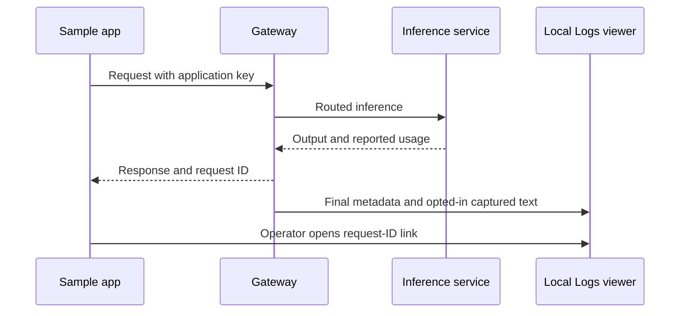

# Everyday gateway and sample-app how-to

## Use this when

Use this page to start or stop a local gateway, run the sample, and demonstrate
LLM logs. Commands below are for the Linux/WSL source checkout, from the repository
root. For Windows or an unpacked native bundle, follow
[portable workstation operations](workstation-distribution.md).

## Prerequisites

- Install the source package once using [local development](local-development.md).
- Have an existing supported inference service and a model available there.
- Back up existing data before upgrading, using [backup and restore](workstation-distribution.md#backup-and-restore).
  Current startup upgrades to schema 9; older binaries require their compatible backup.
- Keep the operator key and application key private. They serve different roles.

The scripts use the checkout's `.venv` automatically; manual activation is unnecessary.
They do not install dependencies or start the inference service. Docker is optional
and remains separate from this local procedure.

## Start, status and stop

```bash
# Gateway
./start.sh
./status.sh

# Sample app, after gateway setup
./examples/chat_app/start.sh
./examples/chat_app/status.sh

# Stop the sample and gateway when finished
./examples/chat_app/stop.sh
./stop.sh
```

Run the stop commands when finished testing, rather than immediately after startup.
Start prints the selected URLs. The gateway tries 8087, 8187, 8287 and subsequent
increments of 100; the sample selects an available port. Use the printed URLs.
Repeated start reuses the managed process; stop preserves data. Status returns
code 3 when stopped. Separate native, source and container data directories can
have different keys and logs.

An exact gateway port can be selected with `./start.sh --port 8187`. If it is
occupied, startup fails without stopping the existing service. The same applies to
an explicit sample port; omit `--port` or use `--port 0` for automatic sample selection.
Full script/storage options are in [guided setup](guided-setup.md) and the
[sample instructions](../../examples/chat_app/README.md).

## Configure and demonstrate logs

1. Open the gateway console URL and authenticate with its operator key.
2. In **Setup**, configure inference, use **Test connection**, save the connection,
   and select an installed model as the default. Discovery tests reachability;
   a completion establishes that inference works.
3. Enable **Capture LLM input and output for all applications**. In **Controls**,
   select retention and a capture limit suitable for the demo.
4. In **Applications**, create an application, optionally assigned to a project.
   Allow both `auto` and the selected concrete model, such as `ollama:gemma3:1b`
   when that model is installed. Copy the full application key shown once.
5. Start the sample. Paste the application key at its hidden prompt, without a
   `Bearer` prefix. Provider credentials belong in the gateway.
6. Send a synthetic prompt. Check the response, reported tokens and request ID.
   Choose **Open gateway log**, authenticate as operator, and inspect **LLM input**,
   **LLM output**, route, status and latency.
7. Test a follow-up, streaming, and Stop. Wait briefly for final recording, then
   refresh Logs. Unavailable usage remains unknown; missing historical content
   cannot be reconstructed by enabling capture later.



See [logging showcase](logging-showcase.md) for filters, paging, exports, retention,
content deletion and recording health. Follow [metadata webhook export](log-export.md)
to add a local receiver and demonstrate outage/restart recovery. That exporter sends
sanitized metadata; captured input/output stays in the local viewer.

## Common problems

| Symptom | Check and recovery |
| --- | --- |
| Sample key rejected | Confirm its displayed gateway URL matches the console where the key was created. Use the full application key; replace a lost/revoked key, then stop/start the sample with the new key. |
| Model forbidden | In Applications, save permissions for both `auto` and the selected concrete route. Existing keys can keep working after this policy change. |
| Gateway cannot complete request | Test the connection in Setup, confirm the model is installed, and inspect the request ID in Logs. See [provider troubleshooting](provider-troubleshooting.md). |
| Input/output unavailable | Check the detail's capture state and gateway capture switch. New settings affect subsequent requests. Expired/deleted/previously disabled content cannot be restored from the inference response. |
| No log yet | Wait for completion/cancellation, refresh, check project/search filters and recording health. Investigate write failures in Storage health. |
| Sample port occupied | Omit the explicit port or use `--port 0`; preserve the service already using that port. |
| Changed settings not applied | Console-managed settings apply as documented. Startup export environment changes require stopping and restarting the gateway in the configured shell. Repeated start reuses the current process. |
| Different keys/logs in Docker | Native and container storage are separate by default. Select the intended instance; use supported encrypted backup/restore for migration. |

## Automated checks and success criteria

```bash
.venv/bin/python -m examples.chat_app.scenarios
.venv/bin/python -m pytest -q tests/test_logging_showcase.py tests/test_log_export.py
npm test --prefix tests/console
```

The scenario suite and tests use isolated temporary stores and synthetic inference.
They do not test your installed model or modify the running gateway. Browser tests
require the console test dependencies from the development procedure.

Success means the sample completion works, the request ID matches the gateway log,
input/output are visible when captured, and usage reflects reported provider counts.
For export, confirm receiver acceptance and persistent retry/recovery counters using
its runbook. Keep live Ollama, visual browser, tunnel and Docker evidence separate
in [validation](../validation.md).

## Recovery and shutdown

Stop the sample with its script, then stop the gateway. Stop a foreground receiver
with Ctrl+C; these actions preserve its private database. For storage failures,
inspect Storage health and use [configuration/storage recovery](configuration-recovery.md).
Preserve the existing database/key pair and restore into a fresh directory when
needed. Backups containing queued deliveries can replay after restore; review the
[export lifecycle](log-export.md#delivery-and-storage-boundaries).

## Configure remote metadata delivery

Use **Log export** to set a receiver endpoint, save its encrypted bearer token, test
the draft and enable delivery. See [console setup](configure-log-export.md). Local
input/output remains in Logs. Startup environment changes require restart; console
saves apply immediately and persist across restart.

For an existing Loki endpoint, select the **loki** adapter and follow
[Loki setup](loki-export.md). The test double also supports a local demonstration
without Docker; live indexing and Grafana browsing require your actual Loki service.

## Optional monitoring

Use the included [monitoring setup](grafana-monitoring.md) with existing Prometheus,
Grafana and optionally Loki. The overview reports traffic/tokens and logging delivery;
the Loki dashboard searches project/app/request metadata. Alerts evaluate in Prometheus;
notifications require separate routing. No optional service starts with the gateway.
