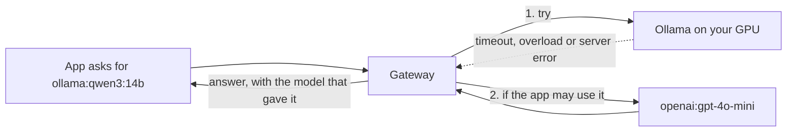

# Fallback routes

## Use this when

Use this to keep an app answering when its model fails, for example when a home GPU is switched off. The gateway
tries a model you choose instead of returning the error. It is off until you turn it on.



## Before you start

A fallback sends the request, including its prompt, to the fallback model's provider. If that is a cloud service,
your prompts leave your machine whenever the primary fails. Decide that per application.

The gateway enforces it: an application falls back only to a model on its own allowed list. An app that is not given
the fallback model never reaches it.

## Set it up

1. **Connect the fallback provider** in **Providers**, if it is not connected already.
2. **Allow the fallback model** for each application that should use it: **Applications**, open the app, and add the
   model to its allowed models.
3. **Add the fallback**: **Features -> Reliability -> Fallback routes**. Turn it on, choose **Add fallback**, and enter
   the model that may fail and the model to try instead, for example `ollama:qwen3:14b` and `openai:gpt-4o-mini`. Add up
   to three for one model; they are tried in order. Save.

The change applies to new requests at once, and appears in **Configuration history** and the audit log.

In a configuration file the same setting is:

```yaml
routing:
  fallback_enabled: true
  fallbacks:
    - model: ollama:qwen3:14b
      fallback: openai:gpt-4o-mini
```

## When it is used

| The first model | Falls back? |
| --- | --- |
| Cannot be reached, or the connection drops | Yes |
| Times out | Yes |
| Answers with a server error (5xx), 408 or 409 | Yes |
| Is overloaded (429) | Yes |
| Rejects the request or the key (other 4xx) | No. The next model would reject it too, or hide a problem you need to fix |
| Is not connected or is turned off in Providers | No |
| Fails during a stream after text was sent | No. The app has already received part of an answer |

Retries happen first. With **Automatic retries** set to three attempts, the gateway tries the first model three times,
then each fallback in turn, three times each. If every model fails, the app gets the last error.

A fallback is skipped when it cannot serve the request, for example because its adapter does not support streaming or
the requested response format. Embeddings never fall back, because vectors from a different model do not match the
ones you already stored. A request for `auto` falls back from the model the gateway chose.

Every request tries the first model first, so traffic returns to it as soon as it recovers.

## What the app sees

The response's `model` field names the model that answered, and the `X-Gateway-Fallback` response header names the
model that failed. Streams carry the answering model in each chunk, as headers are sent before the gateway knows.

## What is recorded

- **Logs:** **Routed model** is the model that answered, and **Fallback from** the one that failed.
- **Usage:** tokens count against the model that answered.
- **Metrics:** `m87_gateway_fallbacks_total` by application and provider, and the failure counts against the first
  model's provider. The Grafana overview has a **Fallbacks per second by application** panel.
- **Cache:** an answer from a fallback is not stored as the first model's answer, so the cache does not keep serving it
  after the first model recovers.

## Limits

- **A dead primary still costs time.** The gateway waits for the first model's error before falling back. A machine that
  refuses connections fails fast. A stopped container on a Docker network took about 4 seconds to fail in testing, and a
  server that accepts the connection but never answers waits for the full **Timeout** set in **Providers**, which is 300
  seconds for Ollama in the Compose setup. Lower it if you rely on fallbacks.
  [Provider health checks](../backlog.md#r2-provider-health-and-circuit-breaking), planned, would skip a known-dead
  provider.
- Fallbacks are per model, not per application. Use allowed models to choose which apps take part.

## Troubleshooting

| What you see | Likely cause |
| --- | --- |
| The error comes back and **Fallback from** is empty | Fallback routes are off, there is no fallback for that exact model, the app may not use the fallback model, or the failure was not one that falls back |
| **Fallback from** is set and the request still failed | The fallback failed too. Check its provider in **Providers** |
| Fallbacks are slow | The first model is timing out. Lower its timeout |
