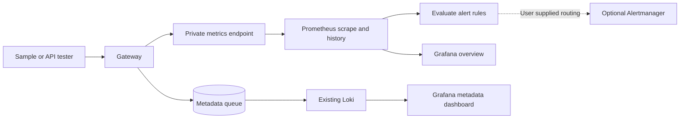

# Grafana dashboards and Prometheus alerts

## Use this when

Use the included monitoring assets with an existing or separately installed
Prometheus and Grafana, plus Loki if you want remote metadata browsing. Gateway
setup remains standalone; these services are optional and are not automatically
installed or started. Docker is not needed to validate the queries/rules.

Prerequisites: operator access to the monitoring services and the gateway's private
network, `/metrics` enabled, and synthetic traffic for testing. No provider, application
or gateway operator key is needed to scrape `/metrics`. Never forward those keys to
Prometheus or Grafana. Keep metrics and monitoring service ports on trusted networks.

Source files live in `deploy/observability/`. Standalone ZIPs include the same files
under `observability/` and this guide as `MONITORING.md`. Adjust paths in commands
below for an extracted ZIP. The templates contain no passwords or deployment identity.



## 1. Point Prometheus at the gateway

Run `./status.sh` to find the actual gateway URL. Default workstation port is 8087;
if it fell back to 8187 or later, edit the target in a private copy of
`prometheus/prometheus.yml`. Preserve job name **m87-gateway**, which scopes the
bundled queries and rules. Multiple targets get separate `instance` labels.

For tools running on the same workstation, the example target is `127.0.0.1:8087`.
A container or remote service needs an address reachable from its own network;
its loopback address points to itself. Do not expose metrics through a public tunnel.
Use a trusted reverse proxy/TLS where a private network connection requires it.

If Prometheus is already running, merge the example scrape job and `rule_files`
entry into its private configuration; do not replace unrelated jobs/rules. If it is
installed but not running, this explicit foreground command uses isolated project
storage and a loopback listener:

```bash
prometheus \
  --config.file=deploy/observability/prometheus/prometheus.yml \
  --storage.tsdb.path=var/lib/monitoring/prometheus \
  --storage.tsdb.retention.time=7d \
  --web.listen-address=127.0.0.1:9090
```

In Prometheus, check **Status → Target health** (or its targets page) for an `UP`
`m87-gateway` target. Send several synthetic requests and allow at least two scrapes
before expecting rates. Inspect `m87_gateway_requests_total` and
`m87_gateway_log_export_enabled` in the query page. Metrics disabled in the gateway
return 404; readiness of inference is separate from scrape availability.

## 2. Import the dashboards

The fastest path uses Grafana's UI:

1. Add a Prometheus datasource pointing to the URL reachable by the Grafana server
   (example `http://127.0.0.1:9090` on the same host). Test/save it.
2. Import `grafana/dashboards/gateway-overview.json` as a Classic dashboard JSON.
3. Select your Prometheus datasource and gateway instance(s) in the dashboard selectors.
4. For logs, first configure the gateway's [Loki export](loki-export.md), add a Loki
   datasource (example server-side URL `http://127.0.0.1:3100`), then import
   `grafana/dashboards/gateway-logs.json` and select that datasource.
5. Set the time range to include the original inference timestamp. Project,
   application and request filters accept regular expressions; `.*` means all.
   For an exact ID use `^example-request-id$`. IDs in JSON do not become stream labels.
6. Copy a sample request ID into the log dashboard's request filter, then find the
   same ID in the gateway's local **Logs** for captured LLM input/output.

The overview includes availability, request/status/app rates, provider token rates,
p95 duration, retries/failures, cache/admission/stream outcomes and logging delivery
health. Tokens are provider-wide process counters, excluding cache hits and unknown
usage; use the gateway console for durable project accounting. No project token totals
are invented from labels that do not exist. No-data remains **Unknown**, not zero.
Latency is an estimated histogram percentile, and long requests can saturate buckets.

The metadata dashboard is optional and needs a real Loki. It contains no input/output;
project/app/request filters operate on JSON fields. Gateways sharing the fixed Loki
labels are combined; choose an isolated datasource/tenant if you need separation.
Duplicate deliveries may appear and are correlated by `delivery_id`. The synthetic
receiver cannot serve this dashboard because it does not implement Loki queries.

### Optional file provisioning

For repeatable deployment, copy `grafana/provisioning/datasources/m87.yaml` and
`grafana/provisioning/dashboards/m87.yaml` into your Grafana provisioning directories.
First edit the datasource URLs for Grafana's server network and set the provider's
`options.path` to the absolute directory containing the two dashboard JSON files.
The example path is `/opt/m87-observability/grafana/dashboards`; it is not created by
the gateway. Use an existing deployment's mount/config paths where appropriate.

Provisioned UIDs are `m87-prometheus` and `m87-loki`; the dashboard source selectors
can also choose other datasources. If you do not use Loki, omit its datasource and
log dashboard from your private deployment copy. Configure credentials separately
through Grafana's supported secret provisioning; never put them in this repository.
Provisioned dashboards are read-only, and UI edits are not a durable source of truth.
Back up existing Grafana configuration first, then restart/reload provisioning as
supported by your installed Grafana. See [Grafana provisioning](https://grafana.com/docs/grafana/latest/administration/provisioning/).

## 3. Review alert thresholds and routing

`prometheus/alerts.yml` contains example operational thresholds. Tune them for local
model speed, traffic volume and maintenance windows before enabling notifications.
Rules are evaluated by Prometheus, not Grafana-managed alerting.

| Alert | Condition and hold | First response |
| --- | --- | --- |
| M87GatewayDown | Configured scrape fails for 2 minutes | Check process, chosen port and network. |
| M87GatewayNoTargets | No job targets for 5 minutes | Check scrape discovery/config; distinguish removed targets from downtime. |
| M87GatewayHighErrorRate | HTTP 5xx >5%, at least 10 requests/5m, held 5m | Inspect gateway/provider logs and connection configuration. |
| M87GatewayHighLatency | p95 >5 seconds, at least 10 requests/5m, held 10m | Inspect provider speed and admission; local LLMs may need a higher threshold. |
| M87GatewayLogWriteFailure | Last completed local log write failed for 1 minute | Check storage, permissions and last successful write. |
| M87GatewayExportStorageFailure | Enabled export storage unhealthy for 1 minute | Check Storage health, disk and competing writers. |
| M87GatewayExportBacklog | Enabled queue has records >2 minutes old, held 5m | Check receiver/TLS/auth and retry counters. |
| M87GatewayExportDrops | Drops increased within 5 minutes | Inspect queue capacity/payload bounds and receiver outage. |
| M87GatewayExportHeld | Enabled export holds another destination's records for 5m | Restore original binding before expiry or review intentional destination changes. |

Alerts describe observations, not automatic remediation. HTTP errors exclude terminal
stream failures after headers; stream outcome panels supplement them. Last-write health
is absent until the first completed write and can stay failed during idle traffic;
send a synthetic request to verify recovery. Disabled export suppresses storage,
backlog and held alerts. Drops remain visible after disabling; they describe actual
lost export metadata. A zero drop count does not prove local recording succeeded.

Notifications require your own Alertmanager receiver/routing. The supplied scrape
config intentionally has no notification destination. Add your private Alertmanager
configuration to Prometheus if needed, for example:

```yaml
alerting:
  alertmanagers:
    - static_configs:
        - targets: ["127.0.0.1:9093"]
```

Do not treat a firing alert in Prometheus as proof an email/page was delivered.
Configure and test notifications separately; no external notification is sent by
this repository's verification.

## Metrics and durability boundaries

Logging metrics are read-only scrape-time health snapshots:

- `m87_gateway_log_writes_total{destination,outcome}` and
  `m87_gateway_log_last_write_ok{destination}`: fixed local destinations only.
- `m87_gateway_log_export_enabled`, `storage_ok`, `pending`,
  `held_for_other_destination`, `awaiting_expiry`, `oldest_pending_at`, `max_pending`.
- `m87_gateway_log_export_{delivered,failed_attempts,dropped,expired}_total`:
  persisted aggregate counters, including prior destinations.

All names above have prefix `m87_gateway_log_export_` where a suffix is listed.
No endpoint, token, prompt, response, request ID, project ID or model is introduced
as a new health-metric label. Existing traffic metrics retain configured application
IDs. Local write counters and inference metrics reset on process restart. Export
counters survive restart; restoring an older backup may decrease them, which rates
handle as resets. Queue counts include held/expired rows until activity prunes them.
Oldest age is absent when the queue is empty. Storage failure suppresses queue/count
samples rather than resetting them to zero; watch the explicit storage health gauge.
Prometheus history, Grafana configuration and Loki retention have separate backups;
the gateway backup does not include those services.

## Verification without running extra services

From a source checkout with development dependencies and an existing `promtool` on PATH:

```bash
.venv/bin/python scripts/check_observability.py
.venv/bin/python -m pytest -q tests/test_monitoring.py
.venv/bin/python -m examples.chat_app.scenarios
```

From an extracted native ZIP you can check the included rules directly without the
source test suite:

```bash
promtool check config observability/prometheus/prometheus.yml
promtool test rules observability/prometheus/alerts.test.yml
```

The source checker validates scrape/rule configuration, evaluates nine alert rules against
synthetic hold/firing/recovery/disabled/low-traffic cases, and parses/evaluates all
24 overview queries on empty input. Python tests also verify the queries reference
real emitted metric names, metrics privacy, unknown state and persistence/recovery.
CI downloads a checksum-pinned official Prometheus 3.5.0 `promtool` to temporary storage.
No gateway user must install that tool to run the product. See
[Prometheus rule tests](https://prometheus.io/docs/prometheus/latest/configuration/unit_testing_rules/).

Actual Grafana import/rendering, Loki ingestion/querying and notification routing
remain separate operational checks. See [validation](../validation.md). When those
services are available, verify one sample request ID and token usage across the app,
local Logs and remote metadata; briefly stop only a disposable receiver to check
backlog/recovery. Use a disposable gateway/storage failure for alert drills, never
change live keys or permissions to create failures.

## Troubleshooting

| Symptom | Check |
| --- | --- |
| Dashboard is empty | Datasource selector, original time range, at least two scrapes, correct job name and actual gateway port. |
| Token rate is missing | Provider usage may be unknown, cache hits excluded, or the provider has no new samples; use local exchange detail. |
| Scrape down but app works | Metrics disabled/404, wrong fallback port, network path or TLS. |
| Queue counts disappear | Check export storage health; unavailable values are omitted. |
| Provisioned dashboards absent | Absolute provider path, filesystem access and Grafana provisioning logs. |
| Loki query fails | Correct datasource/tenant and a real Loki service; the local test receiver cannot query. |
| Alert never fires | Hold period, low-traffic floor, enabled guard and Prometheus rule loading. |
| Alert fires without notification | Alertmanager routing is a separate configuration and delivery test. |

## Shutdown and recovery

Stop only the foreground Prometheus process you started with Ctrl+C. If Grafana/Loki
already serve other workloads, leave them running. Remove only the private copies
of this gateway's provisioning/scrape/rule entries when retiring the integration;
back up first. Stop the sample with `./examples/chat_app/stop.sh` and the gateway
with `./stop.sh` when finished. Preserve gateway and monitoring data directories.
Docker provisioning, managed service lifecycle and automatic ecosystem installation
remain planned; this bundle does not change Docker runtime state.
