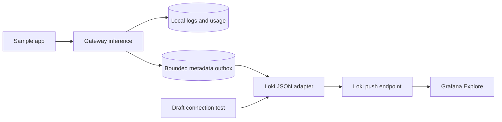

# Send gateway metadata to Loki

## Prerequisites and scope

Use this when you have an existing single-tenant Loki endpoint or a proxy that
accepts bearer authentication. The gateway sends sanitized metadata through the
same SQLite queue used by webhook delivery. Captured LLM input/output remains in
local **Logs**. No new database migration, agent or Docker dependency is required
for the gateway adapter. Loki and Grafana are separate services you supply.

Direct Grafana Cloud Basic authentication, `X-Scope-OrgID` tenant selection, custom
labels, remote content, OTLP and managed service containers remain planned. A trusted
proxy can provide authentication/tenant routing externally. Do not put credentials
in URLs. Do not assume direct Grafana Cloud compatibility from a successful local test.

## Configure and test

1. Back up your gateway data using [portable backup](workstation-distribution.md#backup-and-restore).
2. Open the console → **Log export** and choose adapter **loki**.
3. Enter the complete ingestion URL, for example
   `http://127.0.0.1:3100/loki/api/v1/push`. The adapter does not append a path.
   Use HTTPS for a remote authenticated proxy. A Docker-hosted gateway needs an
   endpoint reachable from its container; container localhost refers to that container.
4. Select no authentication for a private single-tenant Loki, or store the proxy's
   bearer token in the gateway. An environment token is also supported. Follow
   [credential setup](configure-log-export.md) for secret storage and binding changes.
5. Choose **Test connection**. This sends one synthetic `connection_test` line using
   the draft adapter/URL/key, without saving or changing queue/counters. Only `204`
   reports acceptance. Loki or its proxy may retain the synthetic event.
6. Enable metadata export and save. Settings apply immediately. Switching from webhook
   requires a new key or explicit removal confirmation if a credential was configured.
7. Send a synthetic inference request from the sample or API tester. In local **Logs**,
   copy its request ID and check delivery health. In Grafana Explore, select your Loki
   data source and search the same time range:

```logql
{service_name="m87-ai-gateway", log_kind="llm_exchange"} | json
```

Filter a request or project using JSON fields:

```logql
{service_name="m87-ai-gateway", log_kind="llm_exchange"} | json | request_id="example-request-id"
```

```logql
{service_name="m87-ai-gateway", log_kind="llm_exchange"} | json | project_id="default"
```

Request IDs, projects, applications, models and usage are JSON fields. Only
`service_name` and `log_kind` are indexed labels; their fixed values avoid creating
unbounded streams. JSON includes `schema_version`, `delivery_id`, the original
`created_at`, nullable provider token counts, status and timing. Unknown counts stay
null. No prompt, response text, user hash or credential is deliberately exported.



## Delivery boundaries and troubleshooting

The adapter follows the [Loki HTTP push contract](https://grafana.com/docs/loki/latest/reference/loki-http-api/#ingest-logs).
It sends `application/json` with one stream and one entry, a string nanosecond
Unix timestamp derived from the original timezone-aware event time, and a JSON log
line. Only HTTP `204` acknowledges delivery. Loki can return `260`, or a configured
`200`, while ingestion is blocked; other responses remain retryable within expiry.
Redirects are rejected, TLS is verified, proxy environment variables are ignored,
and remote response bodies/errors are excluded from gateway diagnostics.

| Symptom | Check or recovery |
| --- | --- |
| Probe cannot connect | Check full URL, receiver startup, host/container network path, TLS and timeout. |
| Probe rejected | Check bearer token/proxy policy and Loki ingestion configuration. Direct Basic/tenant headers are unsupported. |
| Pending grows after outage | Restore receiver availability; inspect failure/drop/expiry counts in Logs. |
| Old records keep failing | Loki may reject timestamps outside its age or out-of-order window. Align Loki limits with queue retention and possible backup replay; consider receiver restart and clock settings. |
| Accepted but no results in Explore | Select the correct data source, tenant behind the proxy and original event time range; check both fixed labels. A probe proves HTTP acceptance only. |
| Changed destination leaves held rows | Records stay bound to the original adapter/endpoint. Restore that binding to retry before expiry; they are never silently forwarded. |
| Duplicate lines | Retries and backup replay may repeat. Correlate `delivery_id`; downstream deduplication is your responsibility. |

Timestamp, delivery ID and serialized line remain identical across retries. Loki
acknowledgement is not an exactly-once or permanent-retention guarantee. The gateway
sends no webhook idempotency header to Loki and does not assume Loki deduplicates.
An authentication failure, throttling, malformed/old event rejection or blocked
receiver retries with the existing bounded backoff until queue expiry. Health gives
safe aggregate counters, so consult the receiver separately for detailed rejection
reasons. Do not loosen privacy checks or expose credentials while diagnosing.

Disabled export holds matching queued records without new enqueue. A different
adapter/endpoint holds prior rows; token replacement for the same binding affects
retries. Encrypted backup restores may replay pending records. Local content/log
removal does not erase queued metadata or recall Loki data. Use receiver retention
and deletion procedures for remote records.

## Demonstrate without Docker

The bundled receiver understands the adapter's JSON wire format as a test double.
It is not Loki and does not implement LogQL, indexing, retention or Grafana browsing.
From the source root:

```bash
read -rs -p 'Demo receiver bearer token: ' M87_LOG_RECEIVER_TOKEN; echo
export M87_LOG_RECEIVER_TOKEN
.venv/bin/python -m examples.log_receiver.start
```

Choose **loki**, endpoint `http://127.0.0.1:9087/loki/api/v1/push`, and the same token
in Log export. Test, save and send a synthetic sample message. Inspect normalized
stored records using the [receiver procedure](log-export.md#local-demonstration).
The test double deduplicates by delivery ID; that behavior does not establish actual
Loki deduplication. Stop with Ctrl+C.

## Automated verification and shutdown

```bash
.venv/bin/python -m pytest -q tests/test_loki_export.py tests/test_log_export.py
.venv/bin/python -m examples.chat_app.scenarios
npm test --prefix tests/console
```

The sample suite has 18 isolated scenarios, including both webhook and Loki flows.
Tests check exact timestamps/wire bodies, strict acceptance, retry/restart privacy,
credential binding and draft probes. Native smoke verifies Loki selection, stored-key
backup/restore and post-restore delivery. These use synthetic endpoints; a live Loki
and Grafana end-to-end check remains deferred. See [validation](../validation.md).

To finish, disable export and save, stop the sample with `./examples/chat_app/stop.sh`
and the gateway with `./stop.sh`, and stop the demonstration receiver with Ctrl+C.
Your private queue and local logs remain. Operate an existing Loki separately.
