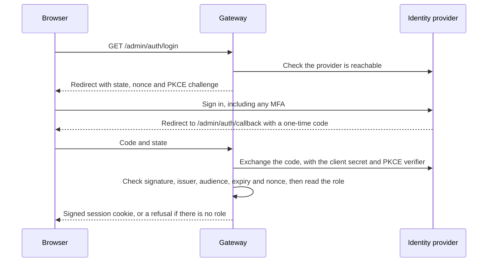

# Single sign-on for the console

## Use this when

Use this to let people sign in to the console through your identity provider instead of sharing the
admin key. Each person gets one of two roles, and the audit log records who did what. It is off until
you set an issuer, and nothing changes for a gateway without one.

Applications are not affected. They keep using their application keys on `/v1`.



## What each role can do

| | Admin | Read-only |
| --- | --- | --- |
| Overview, usage, audit log, configuration history | Yes | Yes |
| Settings, features, providers and applications, as metadata | Yes | Yes |
| Logs, exports and captured input and output | Yes | Yes |
| Any change, including keys, settings, restores and deleting logs | Yes | **No** |
| Stored credential values | Never returned | Never returned |

The gateway enforces this on every request, and the console only hides what would be refused. A new
admin route is admin-only until someone deliberately opens it to read-only, and a test walks every route
to hold that in place.

If capture is on, read-only people can read prompts and responses, so give the role only to people who may
see that content. A person holding both roles is an admin. A person with neither is refused, and the refusal is recorded.
There is no default role.

## Set up the identity provider

These steps are for Keycloak 26. Any OpenID Connect provider works if it can issue roles or groups in
a token; see [Other providers](#other-providers).

1. **Create a client.** Client type OpenID Connect, client ID `m87-gateway`.
2. **Capabilities.** Turn on Client authentication and Standard flow. Leave Direct access grants,
   Implicit flow and Service accounts off.
3. **Login settings.** Use your gateway's public address, with no trailing slash:

   | Field | Value |
   | --- | --- |
   | Valid redirect URIs | `https://gateway.example.com/admin/auth/callback` |
   | Valid post logout redirect URIs | `https://gateway.example.com/admin` |
   | Web origins | `https://gateway.example.com` |

4. **Client roles.** On this client, create the roles `admin` and `readonly`.
5. **Groups.** Create `gateway-admins` and `gateway-readers`, give each the matching client role under
   **Role mapping**, and add people to the groups.
6. **Copy the client secret** from **Credentials**, for the next section.

## Configure the gateway

Add these to `.env` beside `docker-compose.yml`. Keep that file private; Git ignores it.

```bash
GATEWAY_OIDC_ISSUER=https://sso.example.com/realms/example
GATEWAY_OIDC_CLIENT_ID=m87-gateway
GATEWAY_OIDC_CLIENT_SECRET=paste-the-secret-here
GATEWAY_PUBLIC_URL=https://gateway.example.com
```

```bash
docker compose up -d
```

| Setting | Meaning |
| --- | --- |
| `GATEWAY_OIDC_ISSUER` | The provider's issuer URL. Setting it turns sign-on on. |
| `GATEWAY_OIDC_CLIENT_ID` | The client you created. |
| `GATEWAY_OIDC_CLIENT_SECRET` | The client's secret. To use a file instead, such as a Docker secret, set `GATEWAY_OIDC_CLIENT_SECRET_FILE`. |
| `GATEWAY_PUBLIC_URL` | The address people type. The redirect address is built from this, never from the request. |
| `GATEWAY_OIDC_ROLE_CLAIM` | Dotted path to the role list. Default: `resource_access.<client ID>.roles`. |
| `GATEWAY_OIDC_ADMIN_ROLE`, `GATEWAY_OIDC_READONLY_ROLE` | Role names. Defaults: `admin` and `readonly`. |
| `GATEWAY_OIDC_SCOPES` | Default: `openid profile email`. |
| `GATEWAY_OIDC_SESSION_MINUTES` | Console session length, 5 to 720. Default: 60. |

The Compose file passes the first four. Add any others to its `environment` section.

The gateway refuses to start if sign-on is half-configured, or if the issuer or public URL uses plain
HTTP anywhere other than this machine. The message says which setting to fix and never includes the
secret. `docker compose logs m87-ai-gateway` shows it.

The gateway container must be able to reach the issuer URL, and it must be the same URL the browser
uses, because tokens name their issuer.

## Check it works

1. Open the console. **Sign in with SSO** is the main button, and the admin key is under
   **Use the admin key instead**.
2. Sign in as an admin. The sidebar shows your name and **Admin**, and **Audit log** shows
   `console.signed_in` against your name.
3. Sign in as a read-only person. A banner says **Read-only access**, and **Create application** is
   disabled.
4. Sign in as someone with neither role. The page says the account has no role, and the audit log shows
   `console.sign_in_denied`.
5. Choose **Sign out**. Your provider may ask you to confirm. Signing in again asks for your password.

## When the provider is down

The admin key always works, so an outage cannot lock you out. Sessions already signed in carry on until
they expire. To read the key:

```bash
docker compose exec m87-ai-gateway cat /data/gateway/admin.key
```

Actions taken with the key appear in the audit log as `admin-key`, not as a person, so keep it for
recovery and automation.

## Other providers

Roles are read from the ID token first, then from the access token if it is a signed JWT issued to this
client. To use a provider's groups or roles claim, point the gateway at it:

```bash
GATEWAY_OIDC_ROLE_CLAIM=groups
GATEWAY_OIDC_ADMIN_ROLE=gateway-admins
GATEWAY_OIDC_READONLY_ROLE=gateway-readers
```

Only Keycloak has been tested. See [validation](../validation.md).

## Limits

- **Role changes take effect at the next sign-in.** A session lasts `GATEWAY_OIDC_SESSION_MINUTES`, so
  removing someone from a group or disabling them takes up to that long. Lower it for faster removal, or
  change the admin key to end every session at once.
- **The admin key has no attempt throttling yet.** Keep the console off the public internet. See the
  [roadmap](../roadmap.md).
- **`/metrics` is not behind sign-on.** It needs no key, so keep it on a private network.
- **Provider-initiated logout is not supported.** Signing out in the provider ends the console session
  only when it expires.
- **Only the console signs in this way.** The admin API still accepts the admin key as a bearer token.

## Troubleshooting

| What you see | Likely cause | What to do |
| --- | --- | --- |
| Gateway exits with `Single sign-on is misconfigured` | A required setting is missing or not HTTPS | Fix the setting the message names |
| "The identity provider can't be reached" | The container cannot reach the issuer URL, or the discovery document names a different issuer | Check DNS from the container, and that the issuer matches exactly |
| Provider says "Invalid redirect uri" | `GATEWAY_PUBLIC_URL` differs from the client's redirect URI | Make them match exactly |
| "Your account has no role" | No group, or the role is on a different client | Check the person's groups and the client's roles |
| "That sign-in took too long" | Over 10 minutes, or a different browser or tab overwrote it | Try again |
| "Single sign-on failed" | Wrong client secret, or token checks failed | Re-enter the secret, and check the gateway host's clock |
| Signs in, then returns to the login page | The console is on another address than `GATEWAY_PUBLIC_URL`, or HTTPS terminates elsewhere | Open the console at exactly that address |

## Upgrading

Sign-on arrives with store schema 12. The migration adds one audit column and keeps your data, but an
older gateway will then refuse the store, so
[back up](container-deployment.md) before upgrading. Everyone signs in again after the upgrade, because
the session format changed. Older audit entries keep the actor `operator`.
